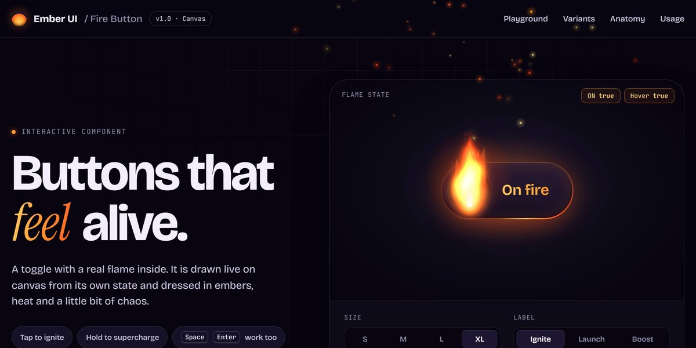

# Canvas Fire Button

Procedural canvas flame toggle with embers, hold-to-supercharge and a live playground.

**Open it:** [`index.html`](index.html) runs straight from disk — one file, every asset inlined, no build step. [Live demo](https://instalanding.ai/demos/fire-button.html) · [Page on InstaLanding](https://instalanding.ai/prompt/canvas-fire-button)

**Build it yourself:** [`PROMPT.md`](PROMPT.md) is the one-shot brief this file was built from. Paste it into any AI builder or coding agent.

| | |
| --- | --- |
| Best for | playful CTAs and toggles, gamified streak UIs, component showcases, launch buttons |
| Style | dark, canvas, particles, glass, playful |
| Sections | nav → hero → variants → anatomy → usage → cta → footer |
| Libraries | none — plain HTML, CSS and JS |
| Fonts | Bricolage Grotesque, Instrument Serif, JetBrains Mono (Google Fonts) |
| Uses | canvas-2d, inline-svg, reduced-motion |
| Size | 73 KB · brief ~1,168 tokens |

Every region is tagged `data-section`, and the file opens with a header comment that maps its design tokens, sections and scripts, and lists what breaks when you edit it. Read that first.

## Built on

- [Fire Button — Rive Marketplace](https://rive.app/marketplace/3703-7734-fire-button/) — The community .riv the first version of this component was built around; the flame here is drawn in code instead

Keep this attribution if you redistribute the component; the original's own terms apply to the parts taken from it.

The brand, copy, numbers and testimonials on this page are fictional. Replace them before you ship.
