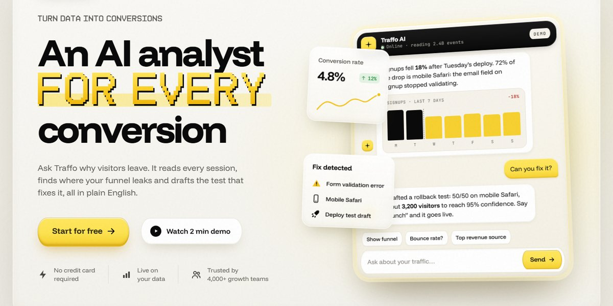

# Clay Constellation SaaS Hero

A tilted live chat demo in a cloud of clay stat cards, pixel-type accents, and buttons that measure themselves.

**Open it:** [`index.html`](index.html) runs straight from disk — one file, every asset inlined, no build step. [Live demo](https://instalanding.ai/demos/traffo-constellation.html) · [Page on InstaLanding](https://instalanding.ai/prompt/clay-constellation-saas-hero)

**Build it yourself:** [`PROMPT.md`](PROMPT.md) is the one-shot brief this file was built from. Paste it into any AI builder or coding agent.

| | |
| --- | --- |
| Best for | AI analytics, product analytics SaaS, AI copilots, growth tools |
| Style | light, clay, warm-paper, pixel-type, yellow-accent |
| Sections | nav → menu → hero → logos → stats → features → product → quote → testimonials → pricing → faq → cta → footer |
| Libraries | gsap 3.12.5 |
| Fonts | Funnel Display, JetBrains Mono (Google Fonts) |
| Uses | inline-svg, inlined-images, reduced-motion |
| Size | 157 KB · brief ~2,751 tokens |

Every region is tagged `data-section`, and the file opens with a header comment that maps its design tokens, sections and scripts, and lists what breaks when you edit it. Read that first.

## Built on

- [Button by dexter-st on Uiverse.io](https://uiverse.io/) — The measuring-frame button this page's design system is built from (MIT)

Keep this attribution if you redistribute the component; the original's own terms apply to the parts taken from it.

The brand, copy, numbers and testimonials on this page are fictional. Replace them before you ship.
