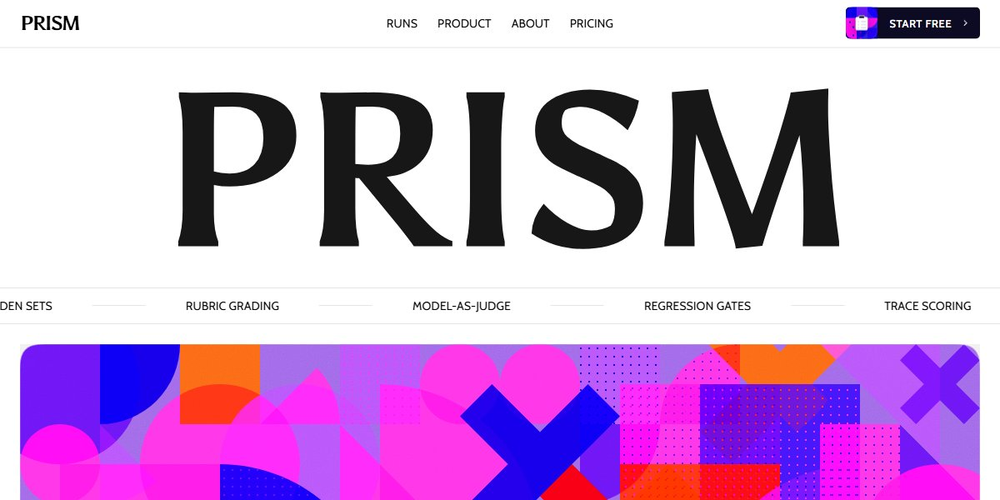

# Generative Editorial Product Page

Fashion-editorial layout for an AI product, every image a gooey generative composition.

**Open it:** [`index.html`](index.html) runs straight from disk — one file, every asset inlined, no build step. [Live demo](https://instalanding.ai/demos/prism-evals-editorial.html) · [Page on InstaLanding](https://instalanding.ai/prompt/generative-editorial-product-page)

**Build it yourself:** [`PROMPT.md`](PROMPT.md) is the one-shot brief this file was built from. Paste it into any AI builder or coding agent.

| | |
| --- | --- |
| Best for | LLM eval platforms, AI quality and CI gates, developer tools, editorial product launches |
| Style | light, editorial, generative-art, gooey, serif |
| Sections | nav → hero → ticker → hero-art → logos → about → runs → product → ticker-2 → testimonials → pricing → cta → contact → footer |
| Libraries | gsap 3.12.5 |
| Fonts | Asul, Cabin, Covered By Your Grace, IBM Plex Mono (Google Fonts) |
| Uses | inline-svg, inlined-images, reduced-motion |
| Size | 103 KB · brief ~1,291 tokens |

Every region is tagged `data-section`, and the file opens with a header comment that maps its design tokens, sections and scripts, and lists what breaks when you edit it. Read that first.

The brand, copy, numbers and testimonials on this page are fictional. Replace them before you ship.
