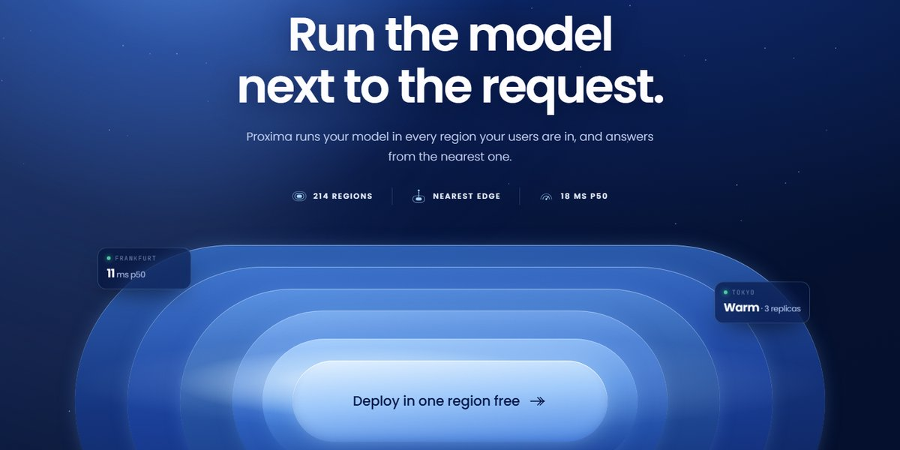

# Radiating Rings Hero Page

Concentric stadium rings radiating out of the call to action, under a streaked orb, with glass readouts floating in the gaps.

**Open it:** [`index.html`](index.html) runs straight from disk — one file, every asset inlined, no build step. [Live demo](https://instalanding.ai/demos/proxima-edge.html) · [Page on InstaLanding](https://instalanding.ai/prompt/radiating-rings-hero-page)

**Build it yourself:** [`PROMPT.md`](PROMPT.md) is the one-shot brief this file was built from. Paste it into any AI builder or coding agent.

| | |
| --- | --- |
| Best for | AI inference and edge networks, cloud infrastructure, developer platforms, usage-based pricing |
| Style | dark, blue, glassmorphism, concentric-rings, pointer-light |
| Sections | nav → hero → features → latency → how-it-works → stats → pricing → faq → cta → footer |
| Libraries | none — plain HTML, CSS and JS |
| Fonts | Poppins, JetBrains Mono (Google Fonts) |
| Uses | inline-svg, inlined-images, reduced-motion |
| Size | 70 KB · brief ~1,134 tokens |

Every region is tagged `data-section`, and the file opens with a header comment that maps its design tokens, sections and scripts, and lists what breaks when you edit it. Read that first.

The brand, copy, numbers and testimonials on this page are fictional. Replace them before you ship.
